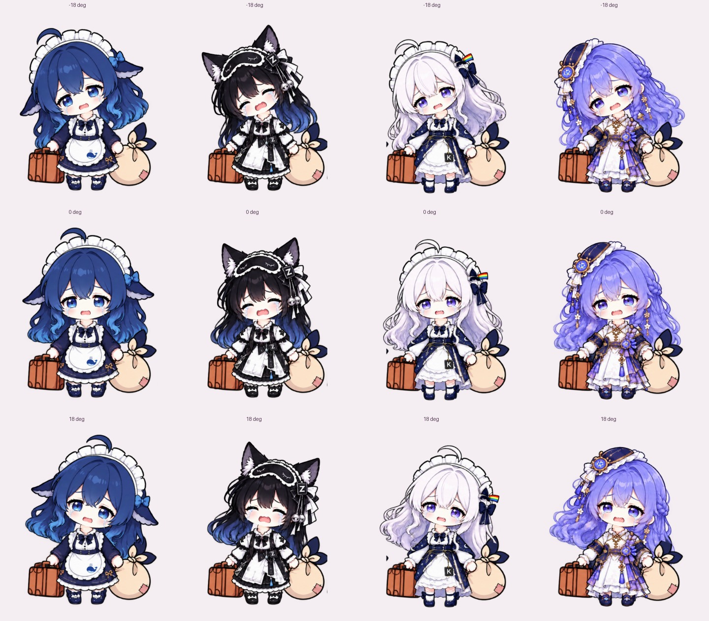

# Desktop Bobbleheads · 桌面弹簧玩偶

四个可以拖动、点击摇头的 Windows 桌面小人。透明窗口直接显示在桌面上，头部按弹簧运动逐渐停下。支持“国模完蛋了”文字气泡，不播放语音。

v1.1.0 支持自定义气泡文字、可选呼吸与眨眼，优化了静止时的后台更新、连续点击的摇头运动和屏幕边缘处理。



## 直接运行

在 [Releases](https://github.com/Howling202524/desktop-bobbleheads/releases/latest) 下载 Windows 便携版，解压后双击 `桌面弹簧玩偶.exe`。

适用于 Windows 10 / 11（64 位），使用 .NET Framework 4.x 和 WPF。程序内嵌图片素材，可单独复制 exe 文件运行，无需 Python、Node.js 或额外素材文件。

## 操作

| 操作 | 效果 |
| --- | --- |
| 单击角色 | 头部弹簧摇动并逐渐停下 |
| 按住左键拖动 | 移动当前角色 |
| 右键 → 说话：国模完蛋了 | 显示文字气泡，4 秒后消失 |
| 右键 → 点击时显示气泡 | 开启或关闭点击时的文字气泡，默认关闭 |
| 右键 → 自定义气泡文字 | 修改所有角色的气泡文字，最多 40 字；可恢复默认 |
| 右键 → 轻微呼吸 | 开启或关闭轻微呼吸，默认关闭 |
| 右键 → 偶尔眨眼 | 睁眼角色偶尔眨眼，默认关闭；猫耳角色保留原来的闭眼表情 |
| 右键 → 放大 / 缩小 | 调整当前角色大小 |
| 右键 → 置于最前 | 切换所有玩偶是否置顶 |
| 右键 → 隐藏 / 退出 | 隐藏当前玩偶或退出程序 |
| 右下角托盘图标 | 显示全部、隐藏全部、恢复默认位置、退出 |
| 双击托盘图标 | 四个角色一起摇头 |

位置、大小、自定义文字和各选项自动保存在 `%LOCALAPPDATA%\FourBobbleheads\settings.xml`，兼容旧版设置。透明区域和文字气泡允许操作后面的窗口。程序不会设置开机自启。

关闭呼吸和眨眼时，头部停下后会停止动画计时器；再次点击即可唤醒。隐藏的角色暂停所有角色动画。连续点击采用平滑限位，头部显示角度保持在 ±18° 内。

拖动、放大、恢复布局和屏幕配置变化时，角色会约束在实际屏幕工作区域内；气泡会在同一屏幕上选择上方或侧方的位置。四个角色共享一次图集解码，透明度数据预先缓存。


## 从源码构建

在 Windows PowerShell 或 PowerShell 7 中，进入仓库根目录运行：

```powershell
powershell -NoProfile -ExecutionPolicy Bypass -File .\src\build.ps1
```

构建使用 Windows .NET Framework 自带的 `csc.exe`，产物位于 `桌面弹簧玩偶\桌面弹簧玩偶.exe`。重新构建前请从托盘菜单退出正在运行的玩偶。

生成便携压缩包：

```powershell
powershell -NoProfile -ExecutionPolicy Bypass -File .\src\package.ps1
```

## 验证

```powershell
$p = Start-Process '.\桌面弹簧玩偶\桌面弹簧玩偶.exe' `
  -ArgumentList '--smoke checks' -PassThru -Wait
$p.ExitCode
Get-Content '.\checks\smoke-test.txt'
```

内置检查会短暂打开四个玩偶窗口，验证弹簧衰减、平滑限位、Windows 鼠标点击、透明区域命中、屏幕边缘放大、旧设置兼容、呼吸/眨眼暂停、自定义文字编辑和文字气泡，并检查停下后的动画计时器不再更新。检查约需 8 秒，会保存四个角色在 -18°、0°、18° 时的截图。退出码 0 表示检查通过；检查模式不会修改个人设置。

已在一块实际显示器上验证交互、边缘布局和窗口行为；负坐标显示器、屏幕间隙及多屏气泡定位使用模拟布局检查。

## 文件

- `src/Bobbleheads.cs`：窗口、弹簧动画、颈部衔接、文字气泡、托盘和设置保存。
- `src/RuntimeSupport.cs`：共享图集与透明度缓存、屏幕工作区域、文字编辑和模型检查。
- `src/build.ps1`、`src/package.ps1`：构建与打包。
- `assets/sprite-parts.png`：透明头部和身体素材图集。
- `assets/sprites.xml`：四个角色的图集坐标、连接位置和眨眼轮廓。
- `assets/source-reference.jpg`：用户提供的原始参考图。
- `assets/generation-prompt.txt`：内置 imagegen 的素材处理提示词。
- `docs/使用说明.txt`：随便携版提供的操作说明。

素材参照原图整理，部分绘制细节与原图略有差异。颈部去除了重复接头，并在左右摇动时保持连接。
